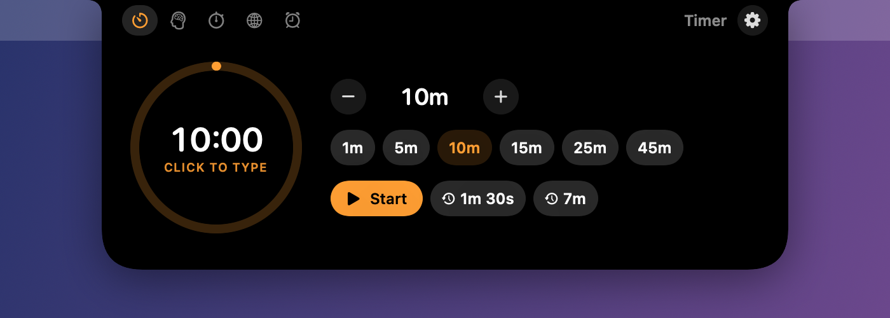
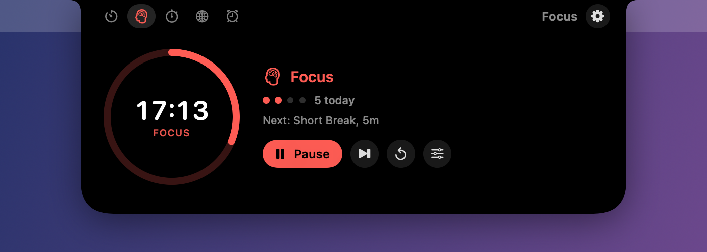
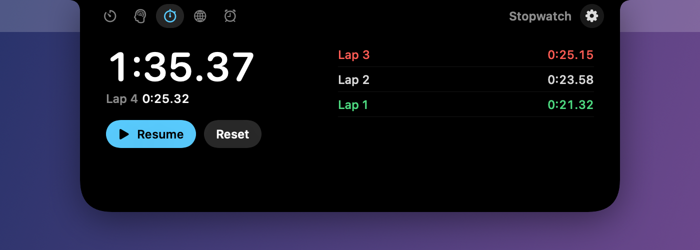
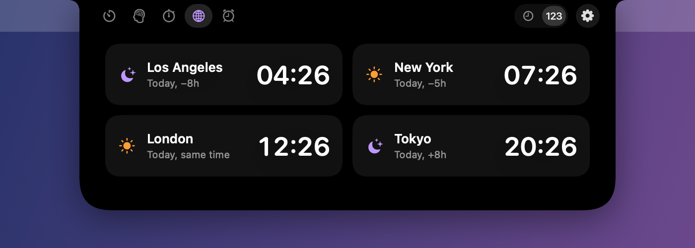
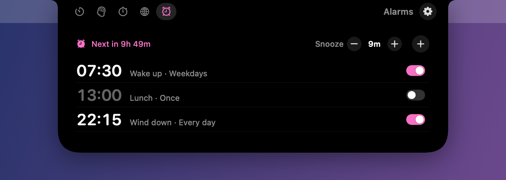

<p align="center">
  
</p>

<h1 align="center">cLockIn</h1>

<p align="center">
  Timers, Focus sessions, a stopwatch, world clocks and alarms, living in your MacBook's notch.<br>
  It grows out of the notch like the iPhone's Dynamic Island.
</p>

<p align="center">
  
</p>

## Features

| | |
|---|---|
|  |  |
| **Timer.** Type any duration (`130` is 1:30), pick a preset or a recent timer, or scroll the ring. | **Focus.** Pomodoro cycles of focus, short and long breaks, with typed lengths and optional auto-start. |
|  |  |
| **Stopwatch.** Hundredths, laps, fastest lap in green and slowest in red. | **World Clock.** Up to four cities, as digital tiles or day and night analog faces. |
|  |  |
| **Alarms.** One-off or repeating, with adjustable snooze. | **Alerts.** A soft glow and chime in the notch, which keeps reminding you until you respond. |

Also:

- **Live activities.** Anything running shows its ring and time beside the notch, two at once (one on each side). An alert you haven't answered shrinks to a `+0:42` reminder.
- **Several timers** at the same time, plus **Focus labels and statistics** with charts, streaks and CSV export.
- **Optional Do Not Disturb** during focus rounds, through two shortcuts you make once.
- **Invisible when idle.** Nothing is drawn until there's something to show, so the notch looks untouched.
- **Keyboard control.** Press <kbd>⌃</kbd><kbd>⌥</kbd><kbd>T</kbd> from any app to open the panel, then use <kbd>Space</kbd> to start or pause, <kbd>←</kbd> <kbd>→</kbd> to switch tabs and digits to type a duration.
- **Follows you.** The island moves to whichever display you're using. Displays without a notch get a small island at the top of the screen.
- **Menu bar backup** with quick controls for everything.
- **Stays up to date.** Once a day it checks GitHub for a new release and offers it in the menu bar and Settings.
- **Private.** No accounts and no analytics. The only network request is the daily update check, which sends nothing about you. You can turn it off.

## Requirements

- macOS 14 Sonoma or later. Best on a MacBook with a notch, but it works on any Mac.
- Apple silicon and Intel are both supported.

## Install

1. Download **`cLockIn-x.y.z.dmg`** from the [latest release](https://github.com/NotAdep/cLockIn/releases/latest).
2. Open it and drag **cLockIn** into **Applications**.
3. Open cLockIn from Applications. Its icon appears in the menu bar; there's no Dock icon.

**If macOS says it can't be opened:** cLockIn isn't from the App Store and isn't notarized by Apple, so the first launch is blocked once. Open **System Settings → Privacy & Security**, scroll down, click **Open Anyway** next to the message about cLockIn, and confirm. You won't be asked again for that version.

New versions show up in the menu bar ("cLockIn x.y.z is available"). You can also use **Check for Updates…** in the menu or **Settings → General**. Download it and drag it into Applications again to replace the old one.

### Build from source

You need Xcode 16 or its command line tools; no Xcode project or Homebrew is required.

```bash
git clone https://github.com/NotAdep/cLockIn.git
cd cLockIn
./scripts/build-app.sh     # builds build/cLockIn.app
./scripts/make-dmg.sh      # or a universal DMG in dist/
```

Builds are signed ad hoc unless you set `CODESIGN_IDENTITY` to a code signing certificate you have.

## Using it

| Do this | To |
|---|---|
| Hover over the notch | Peek: the island grows slightly |
| Click the notch | Open the full panel |
| Click a live activity | Open the panel on that feature |
| <kbd>⌃</kbd><kbd>⌥</kbd><kbd>T</kbd> (changeable) | Open or close the panel from the keyboard |
| Click a ring or time | Type an exact duration or alarm time |
| Scroll over a ring or number | Change it |

With the panel open from the keyboard:

| Key | Action |
|---|---|
| <kbd>Space</kbd> | Start or pause |
| <kbd>←</kbd> <kbd>→</kbd> or <kbd>⌘1</kbd>–<kbd>⌘5</kbd> | Switch tabs |
| <kbd>0</kbd>–<kbd>9</kbd> | Type a duration (Timer and Focus) or an alarm time |
| <kbd>↩</kbd> | Start what you typed, or save an alarm |
| <kbd>L</kbd> / <kbd>R</kbd> | Lap or reset the stopwatch |
| <kbd>Esc</kbd> | Cancel typing, then close |

Settings (the gear in the panel, or <kbd>⌘,</kbd> from the menu bar icon) cover:

- the shortcut and which display the island uses
- alert sounds and repeats, and optional macOS notification banners
- Focus lengths and snooze length
- your World Clock cities and their style

### Good to know

- **Alarms ring while your Mac is awake.** If it was asleep at alarm time, the alarm still rings on wake when it's at most 5 minutes late; later than that it's skipped. macOS doesn't let a regular app wake a sleeping Mac.
- **Black on LCD screens.** The island is pure black. On LCD MacBooks such as the MacBook Air, the backlight makes black pixels slightly lighter than the notch itself, so the island only appears when it has something to show.

## Development

```bash
swift test               # engine tests
./scripts/run.sh         # build, sign, relaunch
swift scripts/make-icon.swift   # redraw the app icon
```

Debug builds include tools for checking the UI without a screen recording:

```bash
CONFIG=debug ./scripts/build-app.sh
build/cLockIn.app/Contents/MacOS/cLockIn --render-snapshots /tmp/shots   # every notch state as PNGs
build/cLockIn.app/Contents/MacOS/cLockIn --readme-shots docs/screenshots # the images in this README
```

`PROBE=1 ./scripts/build-app.sh` makes an optimized build with an animation probe. It opens and closes the panel on command and reports frame timing (see `Sources/cLockIn/Debug/AnimationProbe.swift`).

### Releasing

1. Add a `## x.y.z` section to [CHANGELOG.md](CHANGELOG.md) and set the same version in `Resources/Info.plist`.
2. Commit, then tag and push:

   ```bash
   git tag v0.3.0
   git push origin v0.3.0
   ```

The [Release workflow](.github/workflows/release.yml) runs the tests and builds a universal DMG. It then publishes a GitHub Release with that changelog section as its notes. Installed copies see the update within a day.

### How it's built

- **`Sources/CLockInCore`.** The timer, Focus, stopwatch, alarm and world clock engines. They have no UI and are unit tested. Countdowns store end dates rather than counting ticks, so they stay accurate through sleep and relaunches.
- **`Sources/cLockIn/Notch`.** A borderless, click-through panel above the menu bar. A SwiftUI shape springs between four states: hidden, live activity, alert and the full panel. The panel is built once and kept, so opening it only reveals it. Nothing inside it is an AppKit view, which keeps the animations smooth.
- **`Sources/cLockIn/Features`.** One SwiftUI view per tab.
- **`Sources/cLockIn/App`, `Services` and `Settings`.** App state, the global shortcut (Carbon hot keys, which need no Accessibility permission), sounds, notifications, the update check and the Settings window.

## License

[MIT](LICENSE) © 2026 NotAdep
