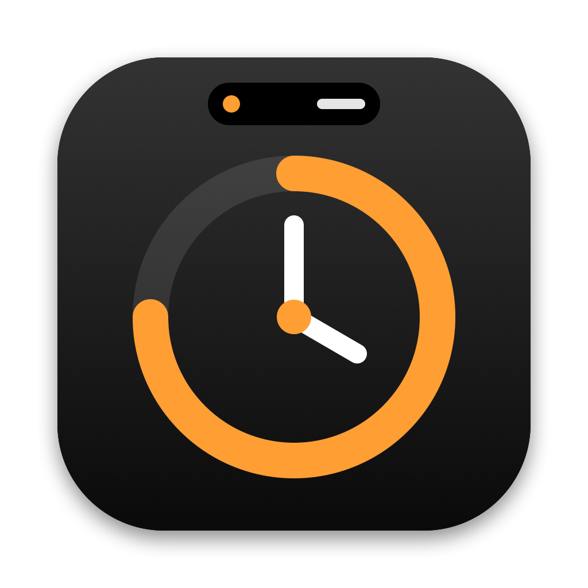

# cLockIn



A macOS clock app that lives in the MacBook notch and expands like the iPhone's Dynamic Island.

- **Timer**: type any duration, use presets or recent timers, or scroll the ring.
- **Focus (Pomodoro)**: focus, short break and long break phases with typed lengths and optional auto-advance.
- **Stopwatch**: laps with the fastest and slowest highlighted.
- **World Clock**: up to four cities with day and night analog faces; manage them in Settings.
- **Alarms**: one-off or repeating alarms with snooze. They ring while the Mac is awake (and up to 5 minutes late after waking).
- **Live activity**: while something runs, the notch widens to show its ring and time. Unanswered alerts keep chiming, then shrink to a "+0:42" reminder.
- **Hover** to peek, **click** to open, or press **⌃⌥T** (configurable). With the shortcut, Space starts or pauses, ← → switch tabs, digits type a duration, Esc closes.
- Follows the display you're using. On displays without a notch it draws a virtual one. Backup controls live in the menu bar.

Requires macOS 14+ and Xcode 16 command line tools. No Homebrew needed.

## Build & run

```bash
./scripts/run.sh          # build, sign, and launch build/cLockIn.app
./scripts/build-app.sh    # just build
swift test                # engine unit tests
```

The app is signed with the `NotAdep Code Signing` certificate when it's in the keychain, otherwise ad hoc
(override with `CODESIGN_IDENTITY=...`). Copy `build/cLockIn.app` to `/Applications` before turning on
"Launch at login".

Regenerate the app icon with `swift scripts/make-icon.swift`.

Debug builds can render every notch state to PNGs, and `PROBE=1` builds can measure animation frame pacing (see `Sources/cLockIn/Debug`):

```bash
CONFIG=debug ./scripts/build-app.sh && build/cLockIn.app/Contents/MacOS/cLockIn --render-snapshots /tmp/notch-shots
```

## Layout

- `Sources/CLockInCore`: the timer and Pomodoro engines (UI-free and unit tested). They store end dates rather than counting ticks, so they stay accurate across sleep.
- `Sources/cLockIn/Notch`: the notch panel, its shape, the state machine (closed, compact, alert, expanded) and the views.
- `Sources/cLockIn/Features`: the Timer and Focus panels.
- `Sources/cLockIn/App`, `Services` and `Settings`: app wiring, notifications, sounds and settings.
